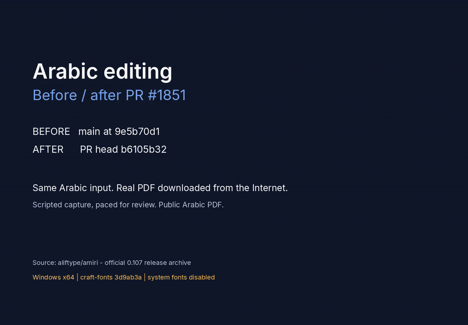

# Arabic editing: before and after PR #1851

[Watch or download the 41-second MP4](pr-1851-amiri-before-after.mp4).

This is a scripted capture of PdfCraft's real egui interface, paced for review. The same Arabic input is typed into a sticky-note popup in both builds. The PR build also replaces an existing heading in a public Arabic PDF, applies the edit, saves and reopens it. Detail views are magnified for readability.

## Compared builds

- Before: main at `9e5b70d1c231d7db558e278a2622b519ca063494`.
- After: PR #1851 at `b6105b3255f6f88bff80fdc3871c1136fa6dc29b`.
- Windows x64; craft-fonts pinned at `3d9ab3a132ed0eff457e424226a435a901da30d3`; `PDFCRAFT_SYSTEM_FONTS=0` in both runs.

## Public test document

The seven-page Arabic manual comes from the [official Amiri 0.107 release](https://github.com/aliftype/amiri/releases/tag/0.107), archive member `amiri-0.107/documentation/documentation-arabic.pdf`. Its SHA-256 is `ac2bc3f5bf6fe73e940cd0a4bdf73dee72775cfa9ed019c9ebca143c99ddef7a`.

The original download remains unchanged. Neither the source PDF nor the edited test PDF is committed. Recording scripts and test outputs remain outside the source repository. This media branch is separate from the PR's code branch.

## Validation

The external harness checks logical clipboard text, a single-row replacement, seven pages after saving, pixel-identical rendering of the edited page before saving versus after reopening, and unchanged rendering of the other six pages against the original. Frames are captured through egui_kittest and encoded with FFmpeg.

The edited heading uses approved Arabic fallback outlines, so its appearance differs from the original subset font. This recording validates this document and these actions; it does not establish compatibility with every PDF.

## Provenance and licences

The recording and title cards are contributor-original under `MIT OR Apache-2.0`. Amiri's documentation and font software are under [OFL-1.1](licenses/Amiri-OFL.txt). The document's DejaVu Sans Mono font uses the [Bitstream Vera licence and associated notices](licenses/DejaVu-LICENSE.txt). The project UI, Lucide icons and other open fonts retain their existing attribution. Full notices are referenced in `NOTICE`; both media files have SHA-256 entries in `ATTRIBUTION.toml`.

No private documents, personal desktop content, installed system fonts, or third-party software screenshots are included. Publication of this recording was approved by the contributor on 2026-10-17.
